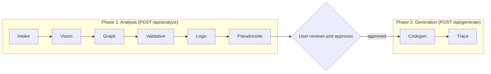
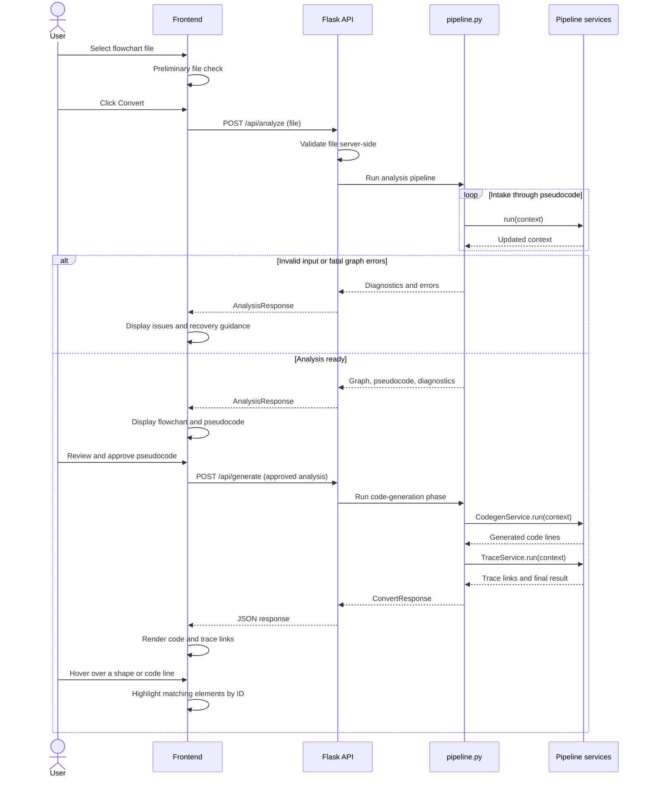

# Modulo (Flowchart-to-Code)

**Upload a completed flowchart. Review the logic. Get traceable Python, generated by rules rather than a language model.**

> **Current implementation — Build 01:** the simple UI and Intake → Vision → Graph → Validation are implemented. You can upload your own PNG, JPG, or single-page PDF and inspect recognized shapes, OCR text, connections, and diagnostics. This build does **not** generate pseudocode or Python; those later-stage files remain scaffolds and approval/generation controls are disabled. A passing response uses `status: "analyzed"`, not `"ready"`. See [`docs/build-01.md`](docs/build-01.md) and [`docs/notation.md`](docs/notation.md). The remainder of this README describes the proposed full application.

> **Local setup verified:** Python 3.12.9, Tesseract 5.5.3, and the pinned dependencies in `requirements.txt`. On macOS, if Control Center/AirPlay occupies port 5000, run `PORT=5001 python backend/app.py` and open <http://127.0.0.1:5001>. Do not stop system services just to run Modulo.

Modulo is an open-source web application that converts a single-page flowchart (PNG, JPG, or PDF) into executable Python. Every step of the conversion is deterministic: computer vision and OCR recognize the diagram, graph algorithms check it, and fixed translation rules turn it into pseudocode and then code. No LLM or AI model is called anywhere in the system.

Built by **West Texas System Solutions** for CS4366: Senior Capstone (Fall 2026).

---

## Table of Contents

1. [Overview](#1-overview)
2. [Purpose and Motivation](#2-purpose-and-motivation)
3. [Scope](#3-scope)
4. [How It Works](#4-how-it-works)
5. [Where It Runs](#5-where-it-runs)
6. [Tech Stack](#6-tech-stack)
7. [Repository Structure](#7-repository-structure)
8. [File Reference](#8-file-reference)
9. [Architecture](#9-architecture)
10. [Features](#10-features)
11. [Getting Started](#11-getting-started)
12. [Testing](#12-testing)
13. [Roadmap](#13-roadmap)
14. [Open Decisions](#14-open-decisions)
15. [License](#15-license)

---

## 1. Overview

A user uploads a finished flowchart. Modulo then:

1. **Recognizes** the diagram's shapes, connectors, and text (OpenCV and Tesseract).
2. **Builds and validates** a graph of the diagram, checking connectivity and structure.
3. **Translates** the supported control flow into pseudocode through an intermediate representation (IR).
4. **Waits for the user to review and approve** the pseudocode.
5. **Generates Python** with deterministic rules and checks that the result is syntactically valid.
6. **Links everything back**: hovering a flowchart shape highlights the pseudocode and code it produced, and hovering a code line highlights the shape it came from.

The core idea is that the user has already done the hard part (designing the logic as a flowchart). Modulo's job is to translate that design faithfully and to show its work.

---

## 2. Purpose and Motivation

- **Structure first, code second.** Prompt-based AI tools produce code whose structure is hard to predict or maintain. Modulo starts from a flowchart, so the program's structure is decided by the user before any code exists.
- **Predictable and explainable.** The same flowchart always produces the same pseudocode and code, and every output line can be traced to a flowchart element and the rule that produced it. This directly serves the three needs raised in the project interviews: a visible link between symbols and code, edge cases that are flagged rather than assumed, and a chance to check behavior before relying on the output.
- **Honest about uncertainty.** Deterministic conversion removes hallucination, but it does not remove recognition errors: the vision and OCR stages can still misread a diagram. That is why Modulo reports diagnostics, flags low-confidence elements, and requires approval before generating code.
- **Open source.** The repository is public so the project can be inspected, run locally, and extended.

**Target users** are non-technical to semi-technical people who supply a proper flowchart and want working code from it. They do not need programming experience, but they are expected to draw in standard notation and to be comfortable in a web browser.

---

## 3. Scope

### 3.1 In scope (MVP)

- Upload one single-page flowchart as PNG, JPG, or PDF.
- Recognize standardized flowchart elements with OpenCV and Tesseract.
- Build a flowchart graph and validate connectivity and structure with explicit algorithms.
- Translate supported control flow into pseudocode through an intermediate representation.
- Show the pseudocode in a **read-only** panel and **require user approval** before any code is generated.
- Generate Python with deterministic rules, then check its syntax (without executing it).
- Preserve source element IDs through every stage, enabling hover highlighting between flowchart, pseudocode, and code.
- Flag ambiguous or unsupported parts of the diagram instead of guessing.
- Copy-to-clipboard and download of the generated script.
- Light and dark themes.
- No sign-in and no saved data after the session.

### 3.2 Not in the MVP (later versions)

- Sign-in and accounts
- Saving projects and version history
- Formal approval sign-off workflow (the MVP has a single Approve action)
- In-browser test mode (running the generated code)
- Editing pseudocode or code and syncing changes back to the flowchart
- In-app correction of misrecognized shapes or text (for the MVP, fix the source diagram and re-upload)
- Output languages other than Python (for example Java and C++)
- Multi-page documents, hand-drawn sketches, and photographs of diagrams

### 3.3 The supported flowchart language

Because conversion is rule-based, Modulo can only translate what it has a rule for. The supported language is a subset of **ISO 5807** flowchart notation. This section is a summary; the complete, authoritative definition lives in [`docs/notation.md`](docs/notation.md) and is encoded in [`backend/notation.py`](backend/notation.py).

| Symbol | Shape | Text it contains | Generated Python |
|---|---|---|---|
| Terminal | Rounded rectangle | `Start` or `End` | Opens and closes the `main()` function |
| Process | Rectangle | A statement such as `total = total + n` | The statement, validated and emitted as written |
| Data Input | Parallelogram | `Input n` or `Input n:int` | `n = input()` or `n = int(input())` |
| Data Output | Parallelogram | `Output total` | `print(total)` |
| Decision | Diamond | A condition such as `n > 0` | `if n > 0:` ... `else:` |
| Iteration | Hexagon | `WHILE <condition>` or `FOR <name> IN <expression>` | `while ...:` or `for ... in ...:` |
| Connector | Small circle | A matching label (`A`, `B`, ...) | Nothing (it only joins parts of the graph) |
| Flow arrow | Arrow | Optional label | Control flow between blocks |

**Supported logic:** sequential execution, if/else (including nested), `while` and `for` loops, variable assignment, logical expressions, input/output, and optional `break`, `continue`, and `return` (drawn as Process boxes containing only that word).

**Edge labels:** every Decision and Iteration shape has exactly two outgoing arrows labeled `Yes` and `No` (also accepted: `True`/`False`, `Y`/`N`, in any letter case). For an Iteration, `Yes` enters the loop body and `No` leaves the loop.

**Statements and conditions** are limited to a small, safe language: names, numbers, strings, arithmetic, comparisons, `and`/`or`/`not`, and a short allowlist of built-ins (`print`, `input`, `int`, `float`, `str`, `len`, `range`, `abs`, `min`, `max`, `round`). Anything else produces a diagnostic rather than being passed into the output.

**Input rules:**

- One page, with exactly one `Start` terminal.
- Digitally drawn diagrams (exported from tools such as draw.io, PowerPoint, Visio, or Lucidchart). Photographs and hand-drawn sketches are not supported.
- Dark lines on a light background, legible text, arrows with visible heads, shapes that do not overlap.
- Structured flow only: the diagram must be expressible as sequences, if/else, and loops. Jumps that cannot be expressed that way are reported as errors, naming the elements involved.

> **Error handling:** error paths drawn as ordinary decisions (for example "File found?" with a `No` path that prints a message) are fully supported. Generating `try`/`except` blocks is an open decision (see [Section 14](#14-open-decisions)).

---

## 4. How It Works

### 4.1 The pipeline

The work is split into two phases with a human approval gate between them.



Each stage is one file in `backend/services/`. Every service has the same shape: it receives the shared `PipelineContext`, adds its results, and returns the updated context.

| Stage | Service | Input to output | Main techniques |
|---|---|---|---|
| 1. Intake | `intake_service.py` | Uploaded bytes to a normalized page image | Decode PNG/JPG, render the PDF page, check it is a single page, scale and clean the image |
| 2. Vision | `vision_service.py` | Page image to recognized shapes, connectors, and text | OpenCV contour and line analysis, geometry-based shape classification, Tesseract OCR with per-word confidence |
| 3. Graph | `graph_service.py` | Recognized elements to a `FlowGraph` | Attach arrow ends to shapes, apply arrowhead direction, attach labels to edges |
| 4. Validation | `validation_service.py` | `FlowGraph` to diagnostics | Start/End checks, reachability, branch checks, statement parsing with Python `ast`, OCR confidence checks |
| 5. Logic | `logic_service.py` | `FlowGraph` to intermediate representation | Structured control-flow recovery (loops, merge points) |
| 6. Pseudocode | `pseudocode_service.py` | IR to numbered pseudocode lines | Template rendering |
| 7. Codegen | `codegen_service.py` | IR to Python source lines | Template rendering plus `ast.parse` and `compile` syntax check |
| 8. Trace | `trace_service.py` | All stages to a two-way trace map | Index of element ID to pseudocode lines to code lines, with a coverage check |

**How the Logic stage recovers structure.** It finds loops by looking for back edges (an edge pointing to a node that dominates its source), finds where the two branches of a decision rejoin (the decision's immediate post-dominator), and then builds the IR as a tree of `Sequence`, `If`, and `While` nodes. If the graph cannot be reduced to those forms, the stage stops with an `UNSTRUCTURED_FLOW` error that names the offending elements. NetworkX may be used internally for dominator and reachability calculations.

**One IR, two renderers.** Pseudocode and Python are both rendered from the *same* IR. What the user approves is therefore exactly what gets generated, and the pseudocode is never re-parsed.

### 4.2 Request lifecycle



Step by step:

1. **Select a file.** `upload.js` runs a preliminary check (extension and size) so the user gets instant feedback. The server never trusts this check.
2. **Click Convert.** `app.js` sends the file to `POST /api/analyze`.
3. **Server-side validation.** `app.py` checks the request itself: file present, size limit, allowed extension, and that the content really is the claimed type.
4. **Analysis pipeline.** `pipeline.analyze()` runs the six analysis services in order. It stops at the first error-level diagnostic.
5. **Failure path.** The response has `status: "failed"` plus diagnostics. The UI explains what went wrong, highlights the affected shapes, and says how to fix the diagram.
6. **Success path.** The context is saved in the analysis store under a random `analysis_id`. The response contains the recognized graph geometry, the pseudocode, and any warnings.
7. **Review and approve.** The user inspects the flowchart and pseudocode side by side. Warnings are shown on the affected elements. Approve is the only way forward.
8. **Generate.** The UI sends only the `analysis_id` to `POST /api/generate`. The server loads the approved analysis from the store; it never accepts analysis content back from the browser.
9. **Expired analysis.** If the ID is unknown or has expired, the user is asked to upload again.
10. **Codegen and trace.** `CodegenService` renders Python from the IR and syntax-checks it. `TraceService` builds the two-way trace map.
11. **Render.** The UI shows the code with trace links.
12. **Hover.** `highlighter.js` highlights every element that shares a source ID with the hovered shape or line.

### 4.3 Traceability: how IDs flow

Every recognized element receives a stable ID in the Vision stage (`n1`, `n2`, ... for nodes and `e1`, `e2`, ... for edges). That ID is carried unchanged through every later stage.

```
n4 (Vision) -> graph node n4 -> IR node source_ids ["n4"]
            -> pseudocode lines 4 and 7 -> Python line 4
```

The frontend marks each shape overlay, pseudocode line, and code line with its source IDs (`data-source-ids="n4"`). One event handler matches on those IDs, so no per-element wiring is needed.

### 4.4 Worked example

A flowchart that reads a number and sums the integers from `n` down to 1:

| Flowchart element | ID | Pseudocode | Python |
|---|---|---|---|
| Terminal `Start` | `n1` | `START` | `def main():` |
| Data Input `Input n:int` | `n2` | `INPUT n` | `n = int(input())` |
| Process `total = 0` | `n3` | `SET total TO 0` | `total = 0` |
| Iteration `WHILE n > 0` | `n4` | `WHILE n > 0` / `END WHILE` | `while n > 0:` |
| Process `total = total + n` | `n5` | `SET total TO total + n` | `total = total + n` |
| Process `n = n - 1` | `n6` | `SET n TO n - 1` | `n = n - 1` |
| Data Output `Output total` | `n7` | `OUTPUT total` | `print(total)` |
| Terminal `End` | `n8` | `END` | End of `main()` |

```python
def main():
    n = int(input())
    total = 0
    while n > 0:
        total = total + n
        n = n - 1
    print(total)


if __name__ == "__main__":
    main()
```

The `if __name__ == "__main__":` lines are fixed scaffolding and carry no source ID. The trace coverage check treats Start, End, and Connector nodes as structural and expects every other node to map to at least one code line.

### 4.5 Determinism rules

For a fixed environment, the same input file produces byte-identical output. Contributors keep it that way by following these rules:

- IDs are assigned in a fixed reading order (top to bottom, then left to right), never in whatever order a library happens to return objects.
- Output is built from lists and sorted collections. Never iterate over a `set` or rely on hash ordering when emitting anything.
- No timestamps, random values, or environment-dependent text in generated pseudocode or code. (`analysis_id` and expiry times are response metadata only.)
- Translation rules live in templates and tables, not in scattered conditionals.
- Recognition (OpenCV, Tesseract) can differ between library versions, so dependency versions are pinned and the Tesseract version is documented. Below the recognition layer, identical graph data always yields identical pseudocode and code.

---

## 5. Where It Runs

- **Client-server architecture.** The browser is the client. A Python Flask server runs the pipeline.
- **Runs locally.** Clone the repository and start the server on your own machine. Flask serves both the API and the static frontend from the same address, so there is no separate frontend server and no cross-origin configuration.
- **Not static hosting.** GitHub Pages cannot run a Python backend. The repository is hosted on GitHub, but Modulo is run from a local clone.
- **No external services.** There are no calls to AI services or any other third-party API. Uploaded flowcharts never leave the machine running the server.
- **No accounts, no persistence.** Nothing is saved after the session. Uploaded data lives only in the server's memory, and only for the short gap between the review step and the generation step (see [Analysis store](#94-analysis-store)). The only thing the browser remembers is the chosen light or dark theme.
- **Browsers.** Current versions of major browsers.

---

## 6. Tech Stack

| Area | Tools |
|---|---|
| Frontend | HTML, CSS, vanilla JavaScript |
| Backend API | Python, Flask |
| Image processing | OpenCV (`opencv-python-headless`), NumPy |
| OCR and PDF processing | Tesseract, `pytesseract`, PyMuPDF |
| Graph representation | Own graph models; NetworkX optionally for graph algorithms |
| Logic and code generation | Python algorithms, templates, intermediate representation |
| Syntax validation | Python `ast` and `compile` checks (source is checked, never executed) |
| Testing | pytest |

**Dependency notes**

- **Tesseract is a system program, not a pip package.** `pytesseract` only calls it, so Tesseract must be installed separately (see [Getting Started](#11-getting-started)).
- **`opencv-python-headless`** is used instead of `opencv-python` because the server needs no GUI libraries.
- **PyMuPDF** is licensed under AGPL-3.0 (with a commercial option). See [Open Decisions](#14-open-decisions) for the implications and a permissive alternative.

---

## 7. Repository Structure

```
modulo/
├── frontend/
│   ├── index.html
│   ├── css/
│   │   └── styles.css
│   └── js/
│       ├── app.js
│       ├── upload.js
│       └── highlighter.js
│
├── backend/
│   ├── app.py
│   ├── config.py
│   ├── models.py
│   ├── notation.py
│   ├── pipeline.py
│   ├── analysis_store.py       # temporary state between phases
│   └── services/
│       ├── intake_service.py
│       ├── vision_service.py
│       ├── graph_service.py
│       ├── validation_service.py
│       ├── logic_service.py
│       ├── pseudocode_service.py
│       ├── codegen_service.py
│       └── trace_service.py
│
├── tests/
│   ├── fixtures/
│   ├── test_intake.py
│   ├── test_vision.py
│   ├── test_graph.py
│   ├── test_validation.py
│   ├── test_logic.py
│   ├── test_pseudocode.py
│   ├── test_codegen.py
│   ├── test_trace.py
│   ├── test_analysis_store.py
│   ├── test_pipeline.py
│   └── test_api.py
│
├── docs/
│   └── notation.md
│
├── samples/
├── .gitignore
├── LICENSE
├── pytest.ini
├── requirements.txt
└── README.md
```

---

## 8. File Reference

### 8.1 Frontend (`frontend/`)

| File | Purpose |
|---|---|
| `index.html` | Page structure: header with theme toggle, upload controls, three side-by-side panels (flowchart, pseudocode, Python), and a diagnostics area. |
| `css/styles.css` | All styling. Defines the color tokens as CSS custom properties for light and dark themes, the panel layout, and the highlight styles. |
| `js/app.js` | Application controller. Holds the UI state (idle, file selected, analyzing, failed, review, generating, done), calls the API, renders the panels and diagnostics, and handles Approve and Start over. |
| `js/upload.js` | File selection and drag-and-drop, the preliminary check (type and size), the file preview, and the progress and cancel behavior during upload. |
| `js/highlighter.js` | Linked highlighting. Matches `data-source-ids` across the flowchart overlay, pseudocode lines, and code lines; supports hover, keyboard focus, and click-to-pin. |

### 8.2 Backend (`backend/`)

| File | Purpose |
|---|---|
| `app.py` | Flask application. Serves the frontend, defines the API routes, validates requests, calls `pipeline.py`, talks to the analysis store, and turns results into JSON. Contains no recognition or translation logic. |
| `config.py` | All tunable settings in one place (upload limits, allowed types, OCR confidence threshold, store lifetime, Tesseract path), with environment-variable overrides. |
| `models.py` | Shared data classes: bounding boxes, nodes, edges, `FlowGraph`, diagnostics, IR nodes, pseudocode lines, code lines, the trace map, `PipelineContext`, `AnalysisResponse`, and `ConvertResponse`. Includes JSON conversion. |
| `notation.py` | The single source of truth for the supported flowchart language: shape types, keywords, edge-label vocabulary, and the allowlist of statement forms and built-ins. Used by Vision, Validation, and Logic. |
| `pipeline.py` | Orchestrator. `analyze()` runs the six analysis services in order and stops at the first fatal error; `generate()` runs Codegen and Trace. Knows nothing about HTTP or storage. |
| `analysis_store.py` | Temporary in-memory storage of an analysis between the review request and the generation request. Expires old entries. Not permanent storage. |
| `services/intake_service.py` | Decodes PNG or JPG, renders the PDF page, rejects multi-page files, and normalizes the image (size, grayscale, threshold) for Vision. |
| `services/vision_service.py` | Finds shapes, connectors, arrowheads, and text. Classifies shapes by geometry, runs OCR with confidence scores, and assigns stable IDs in reading order. If it grows large it may be split into a `vision/` package. |
| `services/graph_service.py` | Turns recognized elements into a `FlowGraph`: connects arrows to shapes, orients edges, attaches labels, and identifies the Start and End nodes. |
| `services/validation_service.py` | Structural and notation checks: one Start, reachable nodes, a path to an End, two labeled branches per decision, paired connectors, parsable and allowed statements, low OCR confidence. Emits diagnostics. |
| `services/logic_service.py` | Converts the validated graph into the intermediate representation (sequences, if/else, loops, break/continue/return) and reports flow it cannot structure. |
| `services/pseudocode_service.py` | Renders the IR into numbered, indented pseudocode lines, each with its source IDs. |
| `services/codegen_service.py` | Renders the IR into Python lines with source IDs, then syntax-checks them with `ast.parse` and `compile`. Never executes the code. |
| `services/trace_service.py` | Builds the two-way trace map (element to pseudocode to code and back), checks that every node is covered, and assembles the final result. |

### 8.3 Tests (`tests/`)

| File or folder | Purpose |
|---|---|
| `fixtures/` | Sample flowchart images and PDFs plus their expected (golden) outputs. |
| `test_intake.py` ... `test_trace.py` | One test file per service. |
| `test_analysis_store.py` | Save, get, expiry, and eviction behavior. |
| `test_pipeline.py` | End-to-end golden tests: fixture in, exact pseudocode and Python out. |
| `test_api.py` | Route tests with Flask's test client: success, failed analysis, bad uploads, expired analysis. |

### 8.4 Root files

| File | Purpose |
|---|---|
| `docs/notation.md` | The full supported-notation specification with drawn examples. |
| `samples/` | Example flowcharts users can try immediately. |
| `.gitignore` | Excludes `__pycache__/`, `.venv/`, `.pytest_cache/`, and similar. |
| `LICENSE` | The project's open-source license (see [Section 15](#15-license)). |
| `pytest.ini` | Puts `backend/` on the import path for tests. |
| `requirements.txt` | Python dependencies. |
| `README.md` | This file. |

---

## 9. Architecture

### 9.1 Layers

```
Browser (frontend/)
    |  HTTP + JSON
Flask API (app.py)          <- request validation, routing, JSON
    |
pipeline.py                 <- orchestration only
    |
services/*                  <- one stage each; pure functions of PipelineContext
    |
models.py / notation.py     <- shared data classes and the notation definition

analysis_store.py           <- used by app.py only
```

Rules that keep the layers clean:

- Services never import Flask and never touch the store. This keeps them testable with plain Python.
- `app.py` never contains recognition or translation logic.
- All services share one data contract (`PipelineContext`), so a stage can be replaced without changing the others. For example, a second Vision implementation could be swapped in.

### 9.2 Data model (`models.py`)

| Class | Holds |
|---|---|
| `BoundingBox` | `x`, `y`, `width`, `height` in pixels of the normalized page image |
| `Node` | `id`, `type` (terminal, process, input, output, decision, iteration, connector), `text`, `bbox`, `confidence`, `flags` |
| `Edge` | `id`, `source`, `target`, `label` |
| `FlowGraph` | nodes, edges, start node ID, end node IDs |
| `Diagnostic` | `severity`, `code`, `message`, `hint`, `element_ids` |
| `IRNode` variants | `Sequence`, `Assign`, `Input`, `Output`, `If`, `While`, `For`, `Break`, `Continue`, `Return`; each carries `source_ids` |
| `PseudocodeLine` / `CodeLine` | `line`, `indent`, `text`, `source_ids` |
| `TraceMap` | element to pseudocode lines, element to code lines, and the reverse maps |
| `PipelineContext` | page image, elements, graph, diagnostics, IR, pseudocode, code, trace |
| `AnalysisResponse` / `ConvertResponse` | The JSON payloads returned by the two phases |

### 9.3 API

| Method | Path | Purpose |
|---|---|---|
| `GET` | `/` | Serves the frontend. |
| `POST` | `/api/analyze` | Accepts the file (multipart form field `file`), runs Phase 1, returns an `AnalysisResponse`. |
| `GET` | `/api/analysis/<analysis_id>/image` | Returns the normalized page image that all coordinates refer to (needed for PDFs, which the browser cannot overlay directly). |
| `POST` | `/api/generate` | Accepts `{ "analysis_id": "..." }`, runs Phase 2, returns a `ConvertResponse`. |

**Request-level problems** (no file, file too large, unsupported type, unknown or expired analysis) return an HTTP 4xx status with `{ "error": "<code>", "message": "..." }`. **Analysis-level problems** (the diagram itself is invalid) return HTTP 200 with `status: "failed"` and diagnostics, because the analysis ran and produced useful results.

Example `AnalysisResponse` (shortened):

```json
{
  "status": "ready",
  "analysis_id": "Zr3k...",
  "expires_at": "2026-10-18T18:30:00Z",
  "page": { "width": 1400, "height": 2000, "image_url": "/api/analysis/Zr3k.../image" },
  "nodes": [
    { "id": "n1", "type": "terminal", "text": "Start", "bbox": [120, 40, 100, 40], "confidence": 0.98 }
  ],
  "edges": [
    { "id": "e1", "source": "n1", "target": "n2", "label": null }
  ],
  "pseudocode": [
    { "line": 1, "indent": 0, "text": "START", "source_ids": ["n1"] }
  ],
  "diagnostics": [
    {
      "severity": "warning",
      "code": "LOW_OCR_CONFIDENCE",
      "message": "The text in this shape may have been misread.",
      "hint": "Check the shape's text, or re-export the diagram at a higher resolution.",
      "element_ids": ["n4"]
    }
  ]
}
```

`bbox` is `[x, y, width, height]`. Diagnostics have three severities: `error` (stops the pipeline), `warning` (shown on the affected elements; the user decides), and `info`.

Common diagnostic codes: `NO_START_NODE`, `MULTIPLE_START_NODES`, `UNREACHABLE_NODE`, `NO_PATH_TO_END`, `DECISION_MISSING_BRANCH`, `DANGLING_ARROW`, `UNSUPPORTED_STATEMENT`, `LOW_OCR_CONFIDENCE`, `UNSTRUCTURED_FLOW`, `SYNTAX_CHECK_FAILED`.

### 9.4 Analysis store

The store exists only to carry an analysis from the review request to the generation request, so the browser never has to send the analysis back.

- **In memory only.** A dictionary guarded by a lock. Nothing is written to disk. Restarting the server clears it.
- **Unguessable IDs.** Generated with Python's `secrets` module.
- **Expires.** Entries are removed after a configurable time (`STORE_TTL_SECONDS`) and the number of entries is capped (`STORE_MAX_ENTRIES`, oldest evicted first). Cleanup happens on each access, so no background thread is needed.
- **Server-held truth.** Because Phase 2 uses the stored IR, a modified request from the browser cannot change what gets generated.
- **Single process.** An in-memory store is not shared between processes. Run Modulo as one server process (the default for local use).

### 9.5 Security notes

- **Generated code is never executed** by the server. It is only parsed and compiled for the syntax check.
- **Text in shapes is untrusted input.** Statements and conditions are parsed with Python's `ast` and accepted only if every node type and function name is on the allowlist in `notation.py`. Attribute access, double-underscore names, imports, lambdas, and unlisted calls are rejected.
- **Uploads are limited** by size and type, and PDFs must be a single page.
- **No outbound network calls** are made while processing a flowchart.

---

## 10. Features

**Conversion**

- Flowchart image or PDF to Python, with no AI model involved
- Documented, explicit notation with clear diagnostics when something falls outside it
- Same input, same output

**Review and safety**

- Read-only pseudocode panel before any code exists
- Approval required before code generation
- Ambiguous branches, low-confidence text, and unsupported constructs are flagged, not assumed
- Syntax check on every generated program
- Copy and download of the generated script

**Traceability**

- Source IDs preserved from recognition through to the final code
- Hover a flowchart shape to highlight its pseudocode and code, and hover a code line to highlight its shape
- Pseudocode lines are linked as well, so the logic can be verified before code is generated

**Experience**

- Side-by-side panels for flowchart, pseudocode, and Python
- Progress indicator and cancel for long-running steps
- Plain-language errors with recovery guidance
- Light and dark themes
- No sign-in, nothing stored

---

## 11. Getting Started

### 11.1 Prerequisites

- **Python 3.10 or newer**
- **Git**
- **Tesseract OCR**, installed on your system:
  - macOS: `brew install tesseract`
  - Ubuntu or Debian: `sudo apt install tesseract-ocr`
  - Windows: install a Windows build of Tesseract (for example the UB Mannheim installer), then set the `TESSERACT_CMD` environment variable to the full path of `tesseract.exe` if it is not on your `PATH`.

### 11.2 Install and run

1. Clone the repository:

   ```bash
   git clone https://github.com/krod7/modulo.git
   cd modulo
   ```

2. Create and activate a virtual environment:

   ```bash
   python -m venv .venv
   source .venv/bin/activate      # Windows: .venv\Scripts\activate
   ```

3. Install the Python dependencies:

   ```bash
   pip install -r requirements.txt
   ```

4. Start the server:

   ```bash
   python backend/app.py
   ```

5. Open <http://127.0.0.1:5000> in your browser, choose a flowchart (try one from `samples/`), and click **Convert**.

### 11.3 Configuration (`backend/config.py`)

Each setting can be overridden with an environment variable of the same name.

| Setting | Meaning | Proposed default |
|---|---|---|
| `MAX_UPLOAD_MB` | Largest accepted upload | `10` |
| `ALLOWED_EXTENSIONS` | Accepted file types | `png`, `jpg`, `jpeg`, `pdf` |
| `TESSERACT_CMD` | Path to the Tesseract executable | unset (use `PATH`) |
| `OCR_MIN_CONFIDENCE` | Below this, text is flagged `LOW_OCR_CONFIDENCE` | `60` |
| `WORKING_IMAGE_WIDTH` | Page images are scaled to this width in pixels | `2000` |
| `PDF_RENDER_DPI` | Resolution used to render PDF pages | `200` |
| `STORE_TTL_SECONDS` | How long an analysis is kept after last use | `1800` |
| `STORE_MAX_ENTRIES` | Maximum analyses held at once | `50` |

---

## 12. Testing

Run everything from the repository root:

```bash
pytest
```

The test strategy takes advantage of the pipeline being deterministic:

- **Unit tests per service** check each stage in isolation using small hand-built inputs.
- **Synthetic diagrams for Vision.** Test images are drawn in code with OpenCV (rectangles, diamonds, arrows, text), so the expected shapes, positions, and text are known exactly.
- **Golden-file tests for the whole pipeline.** Each fixture flowchart has an expected pseudocode file and an expected Python file. Any change in output shows up as a plain diff.
- **Validation tests** include every diagnostic code, including malformed diagrams (missing Start, unreachable nodes, unlabeled branches, unstructured flow).
- **Security tests** confirm that statements outside the allowlist are rejected.
- **Store and API tests** cover expiry, eviction, bad uploads, and unknown analysis IDs.

---

## 13. Roadmap

Planned after the MVP, in no fixed order:

- Sign-in and saved projects with version history
- Formal approval sign-off
- In-browser test mode for generated code
- Editing pseudocode or code with changes reflected back on the flowchart
- In-app correction of misrecognized shapes and text
- More output languages (Java, C++)
- Direct extraction from vector PDFs and diagram-tool exports for higher accuracy
- `try`/`except` generation from error-labeled paths

---

## 14. Open Decisions

| # | Decision | Options and notes |
|---|---|---|
| 1 | **Exception handling** | ISO 5807 has no exception symbol. Option A: an arrow labeled `error` leaving a Process generates `try`/`except` around it. Option B: for the MVP, support error paths only as ordinary decisions. |
| 2 | **`FOR` loop syntax** | Confirm the exact text form (`FOR i IN range(1, 11)`) and how its `Yes`/`No` branches read. Finalize in `docs/notation.md`. |
| 3 | **PDF library and project license** | PyMuPDF is AGPL-3.0, which affects how the project can be licensed. Either license Modulo under AGPL-3.0 or switch PDF rendering to a permissively licensed library such as `pypdfium2`. |
| 4 | **Vector PDFs** | PDFs exported from drawing tools contain exact shape and text data that can be read directly, with no OCR. Decide whether to add this as a second Vision path after the MVP. |
| 5 | **Dependency versions** | Pin versions in `requirements.txt` and record the tested Tesseract version. |

---

## 15. License

Modulo is open source. The license will be chosen and added as `LICENSE` once Open Decision 3 is settled.

Developed by West Texas System Solutions for CS4366: Senior Capstone, Fall 2026.
